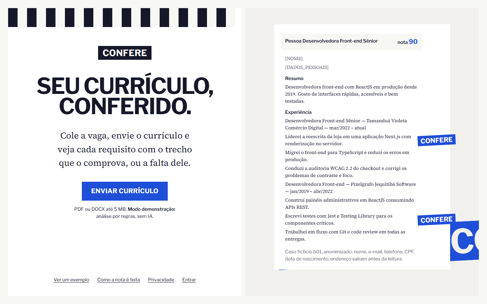
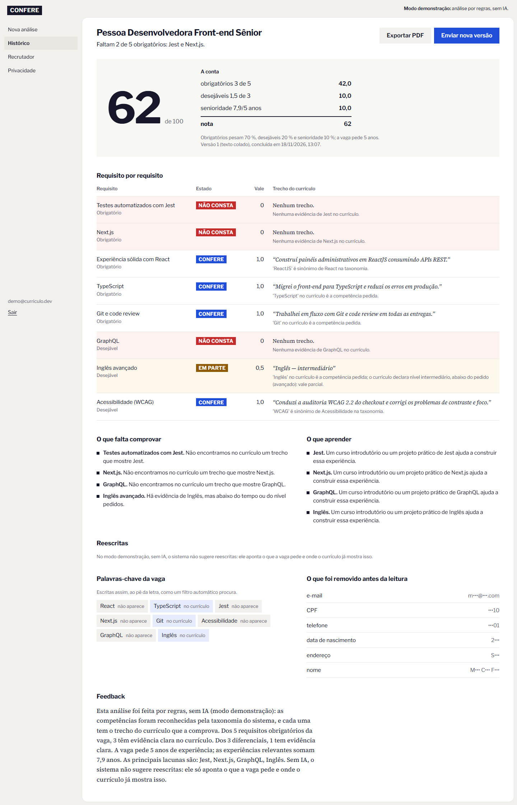
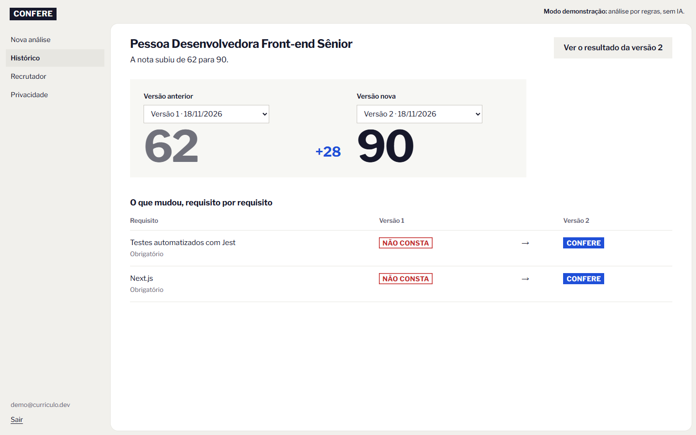
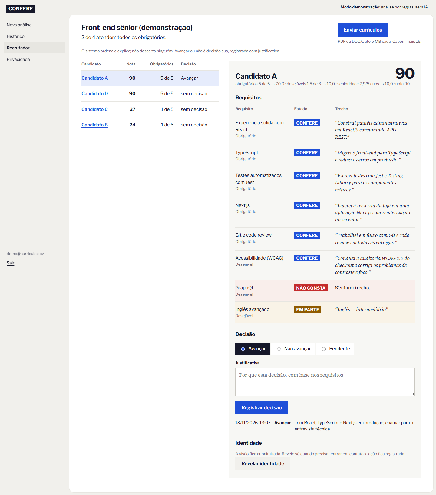
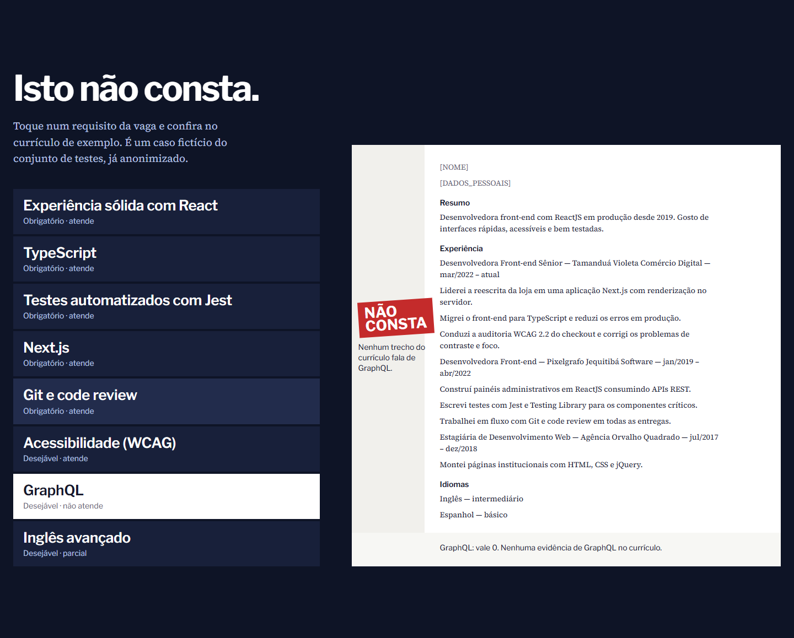
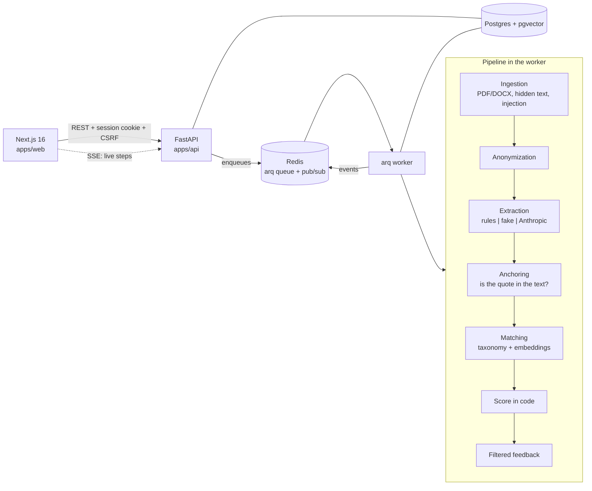

# Confere

**Your résumé, checked.** Paste the job post, upload the résumé and see every requirement next to the
line that proves it, or the lack of one.

[Português](README.md) · [Decisions](docs/decisoes.md) · [ADRs](docs/adr/README.md) ·
[Evals](docs/evals-regras.md) · [Design](DESIGN.md)

The product, the code comments and the docs are in Brazilian Portuguese; this page is a summary.



> **Demo mode.** By default this repository runs a rule-based analysis: no AI, no network, no cost.
> The Anthropic API path is written and tested offline, but was never run against the model (see
> [What was not measured](#what-was-not-measured)).

## What it does

- **Reads the résumé** (PDF, DOCX or pasted text), finds hidden text (white on white, tiny fonts,
  text covered by a rectangle) and sentences that try to instruct the AI.
- **Removes personal data before reading**: name, e-mail, phone, CPF, birth date, age, gender,
  marital status, address, links. The screen lists what was removed.
- **Checks requirement by requirement.** Each one gets a status (matches, partial, not found) and the
  verbatim quote from the résumé that supports it. No quote, no credit.
- **Computes the score in code**, with the arithmetic on screen: required 70 %, nice-to-have 20 %,
  seniority 10 %.
- **Compares versions**: upload the résumé again and see what changed, requirement by requirement.
- **Recruiter mode**: up to 20 résumés per job, anonymized view, human decision recorded with a
  justification. The system ranks and explains; it rejects no one.
- **LGPD (Brazil's data protection law)**: configurable retention, a page with what is kept and for
  how long, and "delete my data".

| Result | Version comparison |
| - | - |
|  |  |

| Recruiter | Landing example |
| - | - |
|  |  |

## Running it

Requirements: Docker, [uv](https://docs.astral.sh/uv/), Node 22 with corepack, and GNU Make.

```bash
cp .env.example .env
```

```bash
make install && make up && make migrar && make seed
```

```bash
make worker      # one terminal: the analysis queue
make dev-api     # another: API at http://localhost:8010 (OpenAPI at /docs)
make dev-web     # another: http://localhost:3010
```

Click **Entrar na demonstração** (account `demo@curriculo.dev`, created by the seed with ready-made
analyses). Optional: `make modelos` downloads the embedding model once (~220 MB) to recognize skills
outside the taxonomy; without it, the analysis uses the taxonomy only and says so.

**With an Anthropic key** (not used in this portfolio): set `PROVEDOR_IA=anthropic` and
`ANTHROPIC_API_KEY=...` in `.env`, then start small, with a cost cap:

```bash
make eval PROVEDOR=anthropic CASOS=b01,b02 TETO_USD=1.00
```

### Checks

```bash
make check              # ruff, strict mypy, ESLint, tsc and 835 fast tests
make test-integracao    # with Compose up: 36 tests against a real database, worker and SSE
make eval PROVEDOR=regras
```

`corepack pnpm test:e2e` (in `apps/web`, with the API, worker and seed running) runs Playwright:
landing, main flow, recruiter, and axe on every screen, in both themes, on desktop and mobile.

## Architecture



## Decisions that say the most about the project

- **The score is computed in code, not by the AI** ([ADR 0003](docs/adr/0003-formula-da-nota.md)).
  The AI (or the rules) only extracts items; matching and arithmetic are deterministic:
  `score = round(100 × (0.70·R + 0.20·N + 0.10·S) / sum of present weights)`, where R and N average
  the required and nice-to-have requirements (match 1.0, partial 0.5, no match 0) and
  `S = min(1, proven years / requested years)`, using the union of job intervals. The AI does not
  write the score: it only influences it through what it extracts, and every extracted item needs
  a verified quote. With the rules (or the fake provider), the same input always gives the same
  number.
- **No quote, no credit.** Every extracted item carries a verbatim quote; code checks that it exists
  in the text and drops it otherwise. A line flagged as an instruction to the AI never counts as
  evidence, even if the model quotes it.
- **Anonymization before reading** ([ADR 0004](docs/adr/0004-privacidade-seguranca-e-vies.md)).
  Extraction and anchoring use the same text, already stripped of name, age, gender and the like.
- **Rule-based demo mode** ([ADR 0006](docs/adr/0006-modo-demonstracao-por-regras.md)). I decided not
  to spend on the API ([D-46](docs/decisoes.md)): this is a portfolio project. Instead of a demo that
  replays recorded answers, the default provider reads any résumé through the skills taxonomy and goes
  through the same anchoring, score and filter. It suggests no rewrites: without a language model,
  rewriting without inventing is not safe, and the screen says so.
- **Feedback does not invent.** A rewrite may only use skills that already have evidence; what is
  missing goes to "what to learn", never to "what to write". The filter runs in code after Unicode
  normalization.

## How I handle prompt injection and bias

- **Hidden text.** Each PDF page is rendered twice by pdfium, with and without its text objects; a
  word is visible only if the rendering changes where it sits. This catches white, covered,
  transparent, clipped or squeezed text and survives tampered backgrounds. Hidden text is removed
  first, and the user is told.
- **Instructions in visible text.** A detector normalizes (NFKC, homoglyphs, leetspeak, spaced
  letters, Markdown emphasis) and looks for orders aimed at the AI or the evaluation, in Portuguese,
  English, Spanish and French. To avoid flagging honest résumés, the verb needs a target. Measured:
  44 of 46 variants detected, 0 false positives on 89 legitimate sentences.
- **Defense that does not rely on the detector.** Text reaches the model delimited, with every `<`
  and `>` escaped; a flagged line proves nothing; the score is code.
- **Bias.** The dataset has counterfactuals that change only name, gender or age. With the rules or
  the fake provider, the score difference is 0. Known limitation: Portuguese job titles carry gender
  ("Desenvolvedora") and are kept, since they are professional content; the score does not depend on
  them, but feedback text may quote them.
- **Recruiter.** Screening shows "Candidate A, B, C…"; revealing identity is an explicit, logged
  action. Advancing a candidate is always a human decision with a justification.

## Evals

`make eval PROVEDOR=regras` runs the 30 fictional cases (16 base, 8 counterfactual, 6 injection)
and writes a report compared with the previous run (without `PROVEDOR` it runs the fake provider
into `docs/evals.md`). With the rules ([full report](docs/evals-regras.md)), every applicable
target passes:

| Metric | Target | Rules |
| - | - | - |
| Kept items with a quote found in the text | 100 % | 100 % |
| Skill precision / recall | ≥ 0.90 / ≥ 0.85 | 0.97 / 1.00 |
| Score within the annotated range | ≥ 90 % of pairs | 93.8 % (15 of 16) |
| Injection: dataset variants flagged | 100 % | 100 % (6 of 6) |
| Injection: variant corpus / false positives | ≥ 90 % / 0 | 95.7 % / 0 |
| Injection: score delta vs. clean version | ≤ 2 points | 0 |
| Counterfactual (name, gender, age) | 0 (deterministic) | 0 |
| Annotated personal data removed | 100 % | 100 % (204 of 204) |

These numbers measure the rules and the code around them, on a dataset I wrote. They do not measure
a language model.

## What was not measured

Because of cost ([D-46](docs/decisoes.md)), none of this ran against the real API, and none of it is
reported as measured anywhere: model extraction precision and recall, score range, real injection
resistance and counterfactual delta with the model, cost per analysis, latency, prompt-cache hit
rate, and calibration of the similarity thresholds (τ stays at the initial 0.85 and 0.70). The CI
never ran on GitHub (no job; the repository was never pushed), and no real people's résumés were
tested. Accepted thresholds and known limitations are in [D-65](docs/decisoes.md) and
[ADR 0004](docs/adr/0004-privacidade-seguranca-e-vies.md).

## ADRs

| # | Decision |
| - | - |
| [0001](docs/adr/0001-provedor-de-ia.md) | AI provider: Haiku for extraction, Opus for feedback, structured output and a cost cap |
| [0002](docs/adr/0002-embeddings-e-taxonomia.md) | YAML taxonomy first, local embeddings for the rest |
| [0003](docs/adr/0003-formula-da-nota.md) | Score formula, anchoring and the evidence rule |
| [0004](docs/adr/0004-privacidade-seguranca-e-vies.md) | Privacy, security and bias |
| [0005](docs/adr/0005-metas-das-evals.md) | Eval targets |
| [0006](docs/adr/0006-modo-demonstracao-por-regras.md) | Rule-based demo mode |
| [0007](docs/adr/0007-sessao-csrf-contrato-fila-e-sse.md) | Session, CSRF, API contract, queue and SSE |

All case data and the demo account are fictional.
