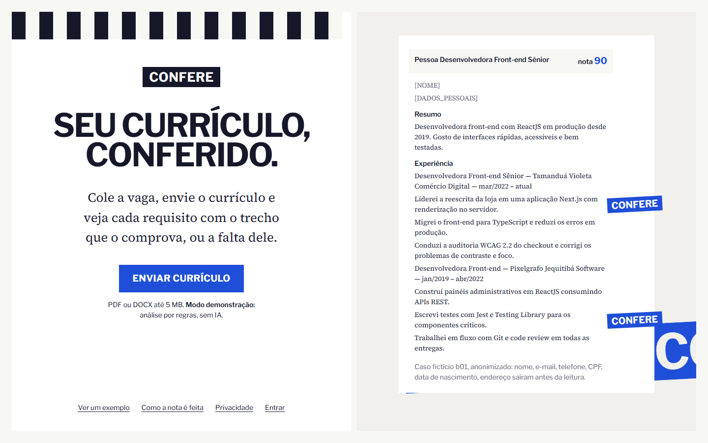
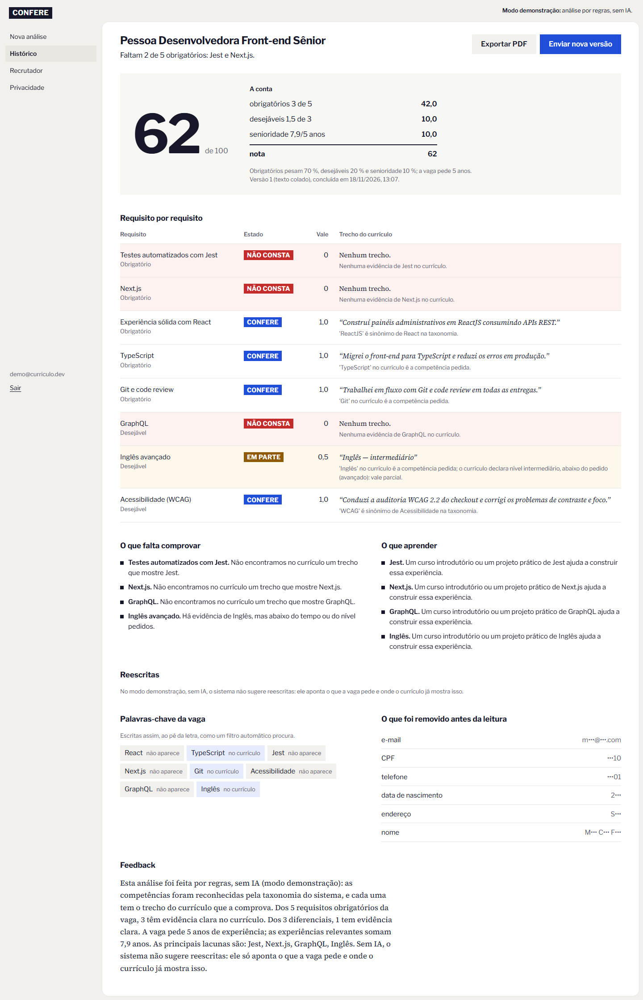
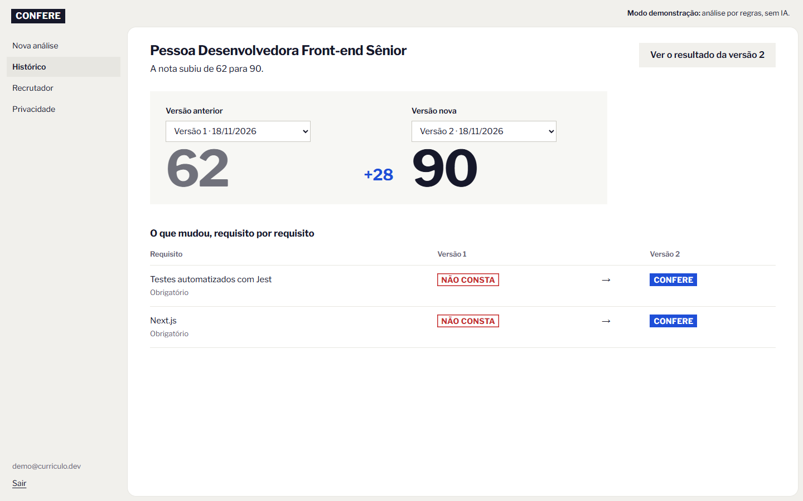
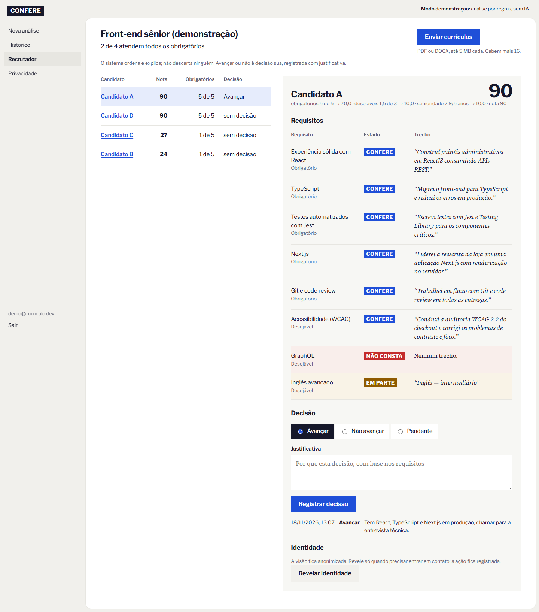
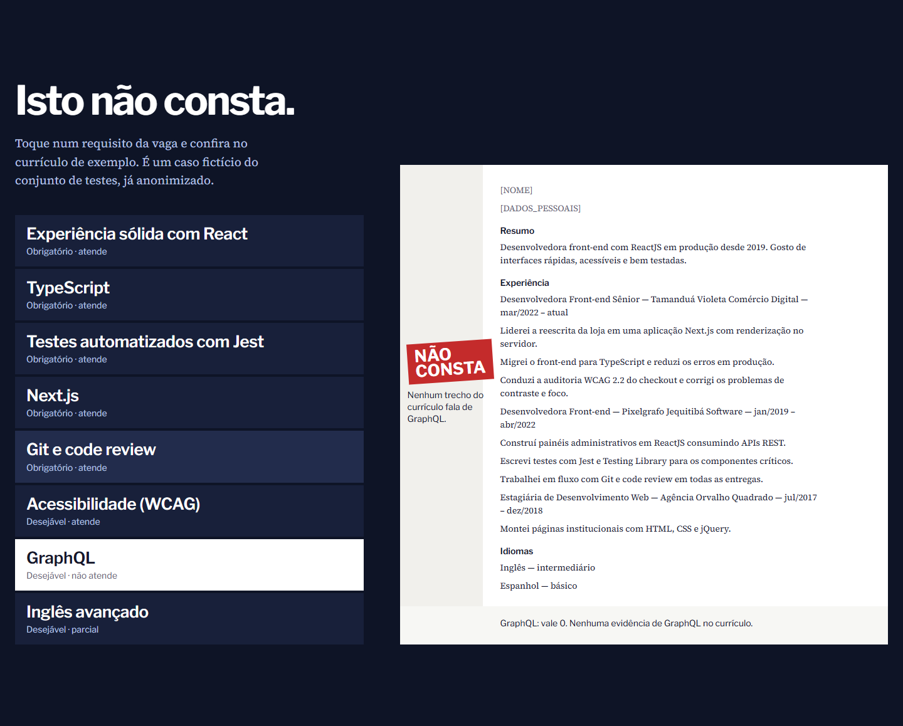
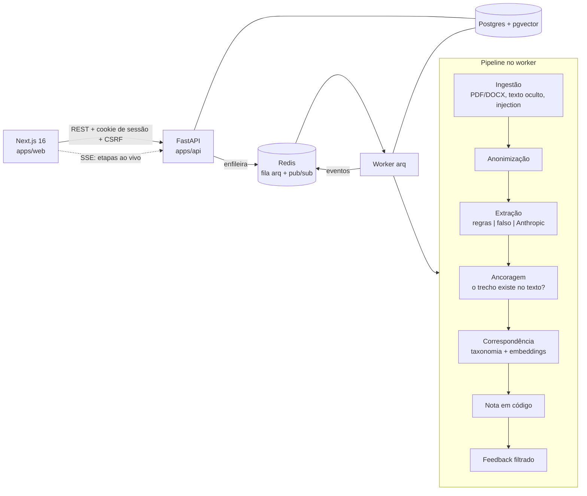

# Confere

**Seu currículo, conferido.** Cole a vaga, envie o currículo e veja cada requisito com o trecho que o
comprova, ou a falta dele.

[English](README.en.md) · [Decisões](docs/decisoes.md) · [ADRs](docs/adr/README.md) ·
[Evals](docs/evals-regras.md) · [Design](DESIGN.md)

**No ar:** [confere-six.vercel.app](https://confere-six.vercel.app) (planos grátis: a primeira visita pode levar até um minuto).



> **Modo demonstração.** Este repositório roda, por padrão, uma análise por regras: sem IA, sem rede
> e sem custo. O caminho com a API da Anthropic está escrito e testado sem rede, mas nunca foi
> executado contra o modelo (veja [O que não foi medido](#o-que-não-foi-medido)).

## O que ele faz

- **Lê o currículo** (PDF, DOCX ou texto colado), acha texto escondido (branco no branco, fonte
  minúscula, coberto por um retângulo) e frases que tentam dar ordens à IA.
- **Tira os dados pessoais antes da leitura**: nome, e-mail, telefone, CPF, nascimento, idade,
  gênero, estado civil, endereço, links. A tela mostra o que saiu.
- **Confere requisito por requisito.** Cada item tem um estado (confere, em parte, não consta) e a
  citação literal do currículo que o sustenta. Sem citação, não conta.
- **Calcula a nota em código**, com a conta à vista: obrigatórios 70 %, desejáveis 20 %,
  senioridade 10 %.
- **Compara versões**: envie o currículo de novo e veja o que mudou, requisito por requisito.
- **Modo recrutador**: até 20 currículos por vaga, visão anonimizada, decisão humana registrada com
  justificativa. O sistema ordena e explica; não descarta ninguém.
- **LGPD**: retenção configurável, página do que é guardado e por quanto tempo, e "apagar meus
  dados".

| Resultado | Comparação |
| - | - |
|  |  |

| Recrutador | O exemplo da landing |
| - | - |
|  |  |

## Como rodar

Pré-requisitos: Docker, [uv](https://docs.astral.sh/uv/), Node 22 com corepack e GNU Make.

```bash
cp .env.example .env
```

```bash
make install && make up && make migrar && make seed
```

```bash
make worker      # em um terminal: a fila das análises
make dev-api     # em outro: API em http://localhost:8010 (OpenAPI em /docs)
make dev-web     # em outro: http://localhost:3010
```

Entre com **Entrar na demonstração** (conta `demo@curriculo.dev`, criada pelo seed com análises
prontas). Opcional: `make modelos` baixa uma vez o modelo de embeddings (~220 MB) para reconhecer
competências fora da taxonomia; sem ele, a análise usa só a taxonomia e avisa.

**Com chave da Anthropic** (não usada neste portfólio): em `.env`, `PROVEDOR_IA=anthropic` e
`ANTHROPIC_API_KEY=...`; depois, comece pequeno, com teto de custo:

```bash
make eval PROVEDOR=anthropic CASOS=b01,b02 TETO_USD=1.00
```

### Verificar

```bash
make check              # ruff, mypy estrito, ESLint, tsc e 846 testes rápidos
make test-integracao    # com o Compose de pé: 36 testes com banco, worker e SSE reais
make eval PROVEDOR=regras
```

`corepack pnpm test:e2e` (em `apps/web`, com API, worker e seed de pé) roda o Playwright: landing,
fluxo principal, recrutador e axe em todas as telas, nos dois temas, no desktop e no celular.

## Arquitetura



| Caminho | O quê |
| - | - |
| `apps/api` | FastAPI, SQLAlchemy 2, Alembic, arq; ingestão, pipeline, provedores, evals ([mapa](apps/api/README.md)) |
| `apps/web` | Next.js 16 e React 19; landing e as telas do app, Playwright e axe |
| `evals/` | 30 casos fictícios (16 base, 8 contrafactuais, 6 de injection), corpora de frases e resultados versionados |
| `docs/` | ADRs, decisões D-01 a D-65, relatórios das evals, direção de design, capturas |

## Decisões que dizem mais sobre o projeto

**A nota é calculada em código, não pela IA** ([ADR 0003](docs/adr/0003-formula-da-nota.md)). A IA
(ou as regras) só extrai itens; a correspondência com a vaga e a conta são determinísticas:

```
nota = round(100 × (0,70·O + 0,20·D + 0,10·S) / soma dos pesos presentes)
O, D = média dos requisitos obrigatórios e desejáveis (atende 1,0 · parcial 0,5 · não atende 0)
S    = min(1, anos comprovados / anos pedidos), pela união dos intervalos das experiências
```

A tela mostra cada parcela. A IA não escreve a nota: só a influencia pelo que extrai, e cada item
extraído precisa de uma citação conferida. Com regras (ou o provedor falso), a mesma entrada dá
sempre o mesmo número.

**Sem trecho, não conta.** Todo item extraído traz a citação literal do currículo. O código confere
que ela existe no texto (normalizando espaços, hifenização e aspas) e descarta o que não existe. Uma
linha marcada como instrução para a IA nunca serve de prova, mesmo que o modelo a cite.

**Anonimização antes da leitura** ([ADR 0004](docs/adr/0004-privacidade-seguranca-e-vies.md)). A
extração e a ancoragem usam o mesmo texto já sem nome, idade, gênero e afins. Um cabeçalho só de
dados pessoais vira um marcador único, para que a forma como cada pessoa preenche o cabeçalho não
mude o texto analisado.

**Modo demonstração por regras** ([ADR 0006](docs/adr/0006-modo-demonstracao-por-regras.md)). Decidi
não gastar com a API ([D-46](docs/decisoes.md)): é um projeto de portfólio. Em vez de um demo que só
repete respostas gravadas, o padrão é um provedor por regras que lê qualquer currículo pela
taxonomia (133 competências, com sinônimos e relacionadas) e passa pela mesma ancoragem, nota e filtro. Ele
não sugere reescritas: sem um modelo de linguagem, reescrever sem inventar não é seguro, e a tela
diz isso.

**O feedback não inventa.** Toda reescrita só pode usar competências que já têm evidência; o que
falta vai para "o que aprender", nunca para "o que escrever". O filtro roda em código, depois de
normalizar Unicode (largura zero, homóglifos).

## Como lido com prompt injection e viés

- **Texto oculto.** Cada página do PDF é desenhada duas vezes pelo pdfium, com e sem os objetos de
  texto; uma palavra só é visível se o desenho muda onde ela está. Isso pega texto branco, coberto,
  transparente, recortado ou comprimido, e resiste a fundos adulterados. O texto oculto sai antes de
  tudo, e a tela avisa.
- **Instruções no texto visível.** Um detector normaliza (NFKC, homóglifos, leetspeak, letras
  espaçadas, ênfase de Markdown) e procura ordens dirigidas à IA ou à avaliação, em português,
  inglês, espanhol e francês. Para não acusar currículos honestos, o verbo exige um alvo: "ignore as
  instruções anteriores" dispara; "ignore as instruções" sem "anteriores", "acima" ou "do sistema",
  não. Medido: 44 de 46 variantes detectadas e
  0 falsos positivos em 89 frases legítimas.
- **Defesa que não depende do detector.** O texto vai ao modelo delimitado, com todo `<` e `>`
  escapado; uma linha marcada não comprova nada; e a nota é código. Uma injection que passe pelo
  detector ainda precisa de uma citação legítima para mudar um requisito.
- **Viés.** O dataset tem contrafactuais que só mudam nome, gênero ou idade. Com regras ou com o
  provedor falso, a diferença de nota é 0 (meta: 0 nos determinísticos, ≤ 2 pontos com o modelo).
  Limitação conhecida: em português o cargo carrega gênero ("Desenvolvedora") e não é removido,
  porque é conteúdo profissional; a nota não depende dele, mas o texto do feedback pode citá-lo.
- **Recrutador.** A triagem mostra "Candidato A, B, C…"; revelar a identidade é uma ação explícita
  e fica registrada. A decisão de avançar é sempre humana, com justificativa.

## Evals

`make eval PROVEDOR=regras` roda os 30 casos e grava um relatório comparando com a execução anterior
(sem `PROVEDOR`, roda o provedor falso e grava `docs/evals.md`). Com as regras
([relatório completo](docs/evals-regras.md)), todas as metas aplicáveis passam:

| Métrica | Meta | Regras |
| - | - | - |
| Itens mantidos com trecho no texto | 100 % | 100 % |
| Precisão / cobertura de competências | ≥ 0,90 / ≥ 0,85 | 0,97 / 1,00 |
| Nota dentro da faixa anotada | ≥ 90 % dos pares | 93,8 % (15 de 16) |
| Injection: variantes do dataset sinalizadas | 100 % | 100 % (6 de 6) |
| Injection: corpus de variantes / falsos positivos | ≥ 90 % / 0 | 95,7 % / 0 |
| Injection: diferença de nota contra a versão limpa | ≤ 2 pontos | 0 |
| Contrafactual (nome, gênero, idade) | 0 (determinístico) | 0 |
| Dados pessoais anotados removidos | 100 % | 100 % (204 de 204) |

Esses números medem as regras e o código ao redor (ancoragem, nota, filtros, anonimização), sobre
um dataset que eu mesmo escrevi. Não medem um modelo de linguagem.

## O que não foi medido

Por decisão de custo ([D-46](docs/decisoes.md)), nada disto rodou contra a API real, e nenhum
número disto aparece como medido em lugar nenhum:

- precisão e cobertura da extração feita pelo modelo, e quantos itens ele cita errado;
- nota na faixa, resistência real a injection e diferença contrafactual com o modelo;
- custo por análise, latência, acerto do prompt caching;
- a calibração dos limiares de similaridade (τ continua 0,85 e 0,70, os valores iniciais).

Também não rodaram: o CI no GitHub (nenhum job; o repositório nunca foi enviado) e um teste com
currículos reais de pessoas.
Os limiares aceitos e as limitações conhecidas estão em [D-65](docs/decisoes.md) e no
[ADR 0004](docs/adr/0004-privacidade-seguranca-e-vies.md).

## ADRs

| # | Decisão |
| - | - |
| [0001](docs/adr/0001-provedor-de-ia.md) | Provedor de IA: Haiku na extração, Opus no feedback, saída estruturada e teto de custo |
| [0002](docs/adr/0002-embeddings-e-taxonomia.md) | Taxonomia YAML primeiro, embeddings locais para o resto |
| [0003](docs/adr/0003-formula-da-nota.md) | Fórmula da nota, ancoragem e regra da evidência |
| [0004](docs/adr/0004-privacidade-seguranca-e-vies.md) | Privacidade, segurança e viés |
| [0005](docs/adr/0005-metas-das-evals.md) | Metas das evals |
| [0006](docs/adr/0006-modo-demonstracao-por-regras.md) | Modo demonstração por regras |
| [0007](docs/adr/0007-sessao-csrf-contrato-fila-e-sse.md) | Sessão, CSRF, contrato da API, fila e SSE |

Os dados dos casos e da conta demo são fictícios.

## Licença

[MIT](LICENSE).
